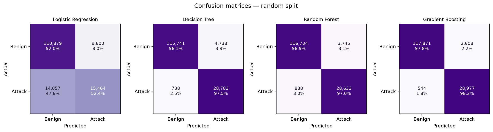
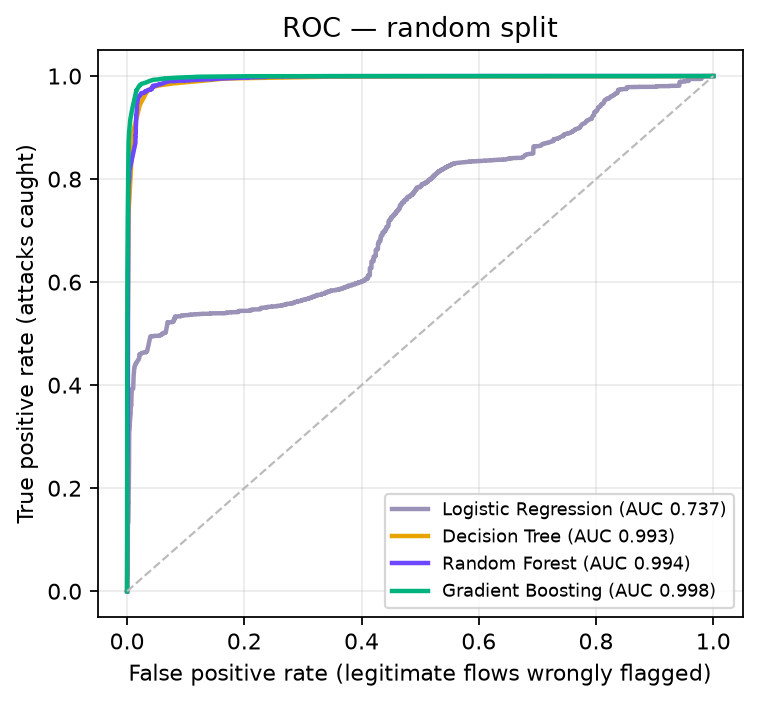
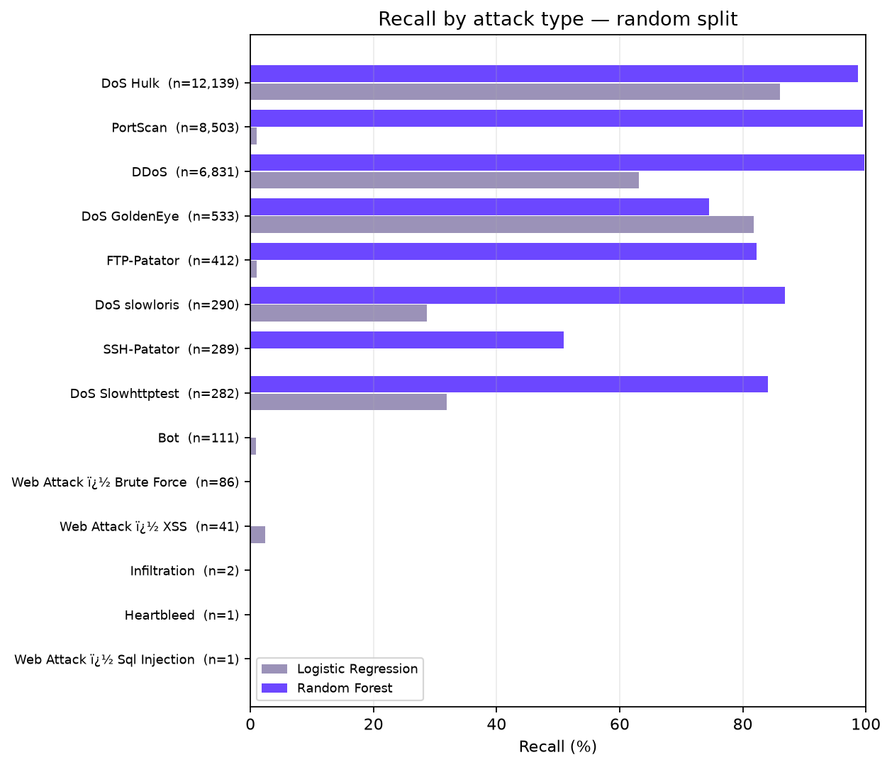
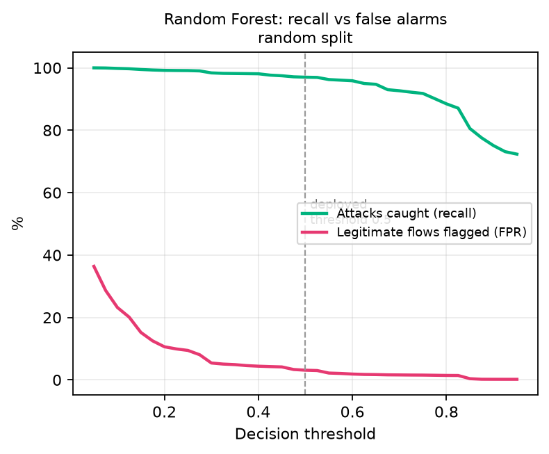
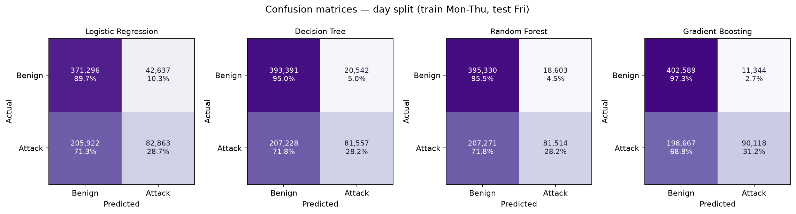
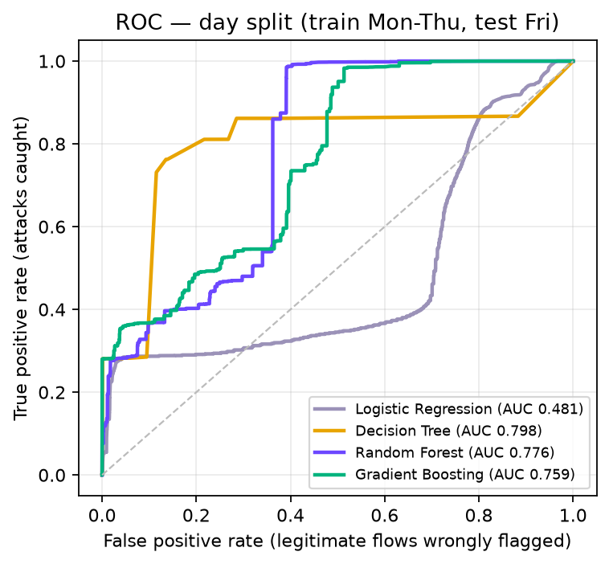
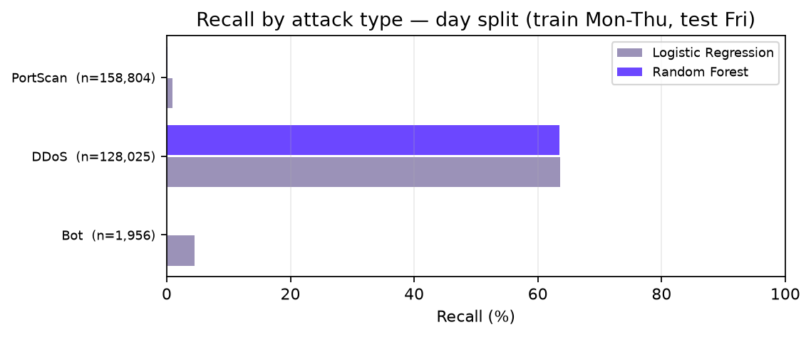
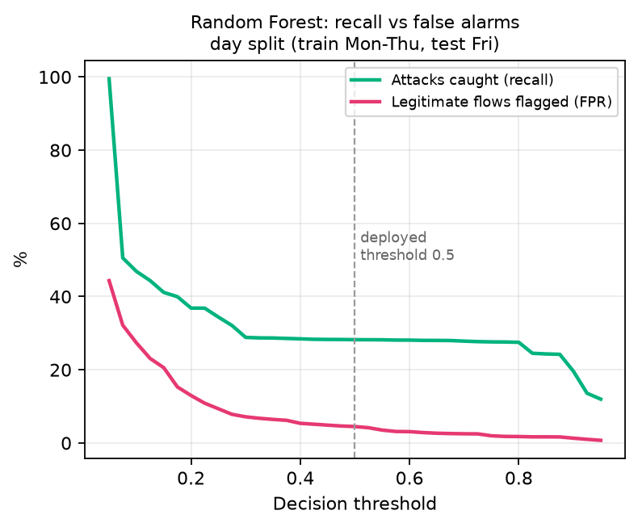
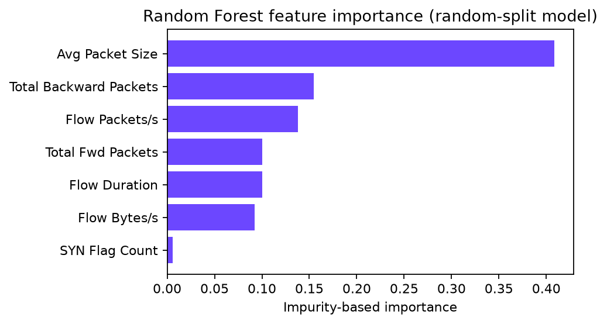

# Evaluation — draft results chapter

_Generated 2026-10-20 16:21 by `ml/evaluate.py`. Numbers below are computed, not typed in. The wording is a draft: read it, and edit it to match your own discussion._

## 1. Data and features

The CICIDS2017 CSVs (`MachineLearningCVE`) contain 2,827,876 usable flows after removing rows with missing or infinite values: 2,271,320 benign (80.3%) and 556,556 attack (19.7%). Every non-BENIGN label is treated as one class, “attack”, so the task is binary.

Seven features are used, chosen because the proxy can compute an equivalent for a live client: *Flow Duration*, *Total Fwd Packets*, *Total Backward Packets*, *Flow Bytes/s*, *Flow Packets/s*, *Avg Packet Size*, *SYN Flag Count*.

Because the data is imbalanced, accuracy alone is misleading (predicting “benign” for everything would already score 80.3%). Precision, recall, F1, the false-positive rate and the confusion matrix are therefore reported, and models are trained with balanced class weights.

## 2. Method

Four models are compared on identical features: **Logistic Regression** (linear baseline), a single **Decision Tree** (depth 7), a **Random Forest** (30 trees, depth 7, the configuration exported to the proxy) and **Gradient Boosting** (a stronger reference that is not deployed, since the proxy evaluates plain trees).

* **Protocol A — random split.** 600,000 flows sampled (stratified), 75% train / 25% test.
* **Protocol B — day split.** Train on Monday–Thursday, test on Friday. Friday contains DDoS, PortScan and Bot traffic, which do not occur in Monday–Thursday, so this tests detection of attack types never seen in training.

## 3a. Results: Protocol A — random split

Test set: 120,479 benign and 29,521 attack flows.

| Model | Accuracy | Precision | Recall | F1 | False-positive rate | ROC-AUC |
|---|---|---|---|---|---|---|
| Logistic Regression | 84.23% | 61.70% | 52.38% | 56.66% | 7.97% | 0.7366 |
| Decision Tree | 96.35% | 85.87% | 97.50% | 91.31% | 3.93% | 0.9931 |
| Random Forest **(deployed type)** | 96.91% | 88.43% | 96.99% | 92.52% | 3.11% | 0.9941 |
| Gradient Boosting | 97.90% | 91.74% | 98.16% | 94.84% | 2.16% | 0.9976 |

Confusion matrix of the Random Forest at the deployed threshold (0.5):

| | Predicted benign | Predicted attack |
|---|---|---|
| **Actual benign** | 116,734 (true negatives) | 3,745 (false positives) |
| **Actual attack** | 888 (false negatives) | 28,633 (true positives) |

Of every 1,000 legitimate flows the Random Forest wrongly flags about **31.1**, and it misses about **3.0%** of attack flows.

Moving the threshold trades one error for the other: to hold false alarms at or below 1% the threshold becomes 0.84 and recall is 81.57%; at or below 0.1% it becomes 0.99 and recall is 27.57%.

Recall by attack type (threshold 0.5):

| Attack type | Test flows | Logistic Regression | Decision Tree | Random Forest | Gradient Boosting |
|---|---|---|---|---|---|
| DoS Hulk | 12,139 | 86.09% | 98.62% | 98.71% | 98.75% |
| PortScan | 8,503 | 1.07% | 99.52% | 99.53% | 99.72% |
| DDoS | 6,831 | 63.07% | 99.77% | 99.77% | 99.80% |
| DoS GoldenEye | 533 | 81.80% | 90.99% | 74.48% | 96.62% |
| FTP-Patator | 412 | 0.97% | 100.00% | 82.28% | 99.76% |
| DoS slowloris | 290 | 28.62% | 85.17% | 86.90% | 98.28% |
| SSH-Patator | 289 | 0.00% | 51.56% | 50.87% | 51.56% |
| DoS Slowhttptest | 282 | 31.91% | 73.05% | 84.04% | 97.87% |
| Bot | 111 | 0.90% | 28.83% | 0.00% | 49.55% |
| Web Attack � Brute Force | 86 | 0.00% | 3.49% | 0.00% | 3.49% |
| Web Attack � XSS | 41 | 2.44% | 0.00% | 0.00% | 0.00% |
| Infiltration | 2 | 0.00% | 0.00% | 0.00% | 0.00% |
| Heartbleed | 1 | 0.00% | 100.00% | 0.00% | 0.00% |
| Web Attack � Sql Injection | 1 | 0.00% | 0.00% | 0.00% | 0.00% |

## 3b. Results: Protocol B — day split (train Mon–Thu, test Fri)

Test set: 413,933 benign and 288,785 attack flows.

| Model | Accuracy | Precision | Recall | F1 | False-positive rate | ROC-AUC |
|---|---|---|---|---|---|---|
| Logistic Regression | 64.63% | 66.03% | 28.69% | 40.00% | 10.30% | 0.4805 |
| Decision Tree | 67.59% | 79.88% | 28.24% | 41.73% | 4.96% | 0.7976 |
| Random Forest **(deployed type)** | 67.86% | 81.42% | 28.23% | 41.92% | 4.49% | 0.7759 |
| Gradient Boosting | 70.11% | 88.82% | 31.21% | 46.19% | 2.74% | 0.7585 |

Confusion matrix of the Random Forest at the deployed threshold (0.5):

| | Predicted benign | Predicted attack |
|---|---|---|
| **Actual benign** | 395,330 (true negatives) | 18,603 (false positives) |
| **Actual attack** | 207,271 (false negatives) | 81,514 (true positives) |

Of every 1,000 legitimate flows the Random Forest wrongly flags about **44.9**, and it misses about **71.8%** of attack flows.

Moving the threshold trades one error for the other: to hold false alarms at or below 1% the threshold becomes 0.93 and recall is 12.89%; at or below 0.1% it becomes 0.98 and recall is 7.62%.

Recall by attack type (threshold 0.5):

| Attack type | Test flows | Logistic Regression | Decision Tree | Random Forest | Gradient Boosting |
|---|---|---|---|---|---|
| PortScan | 158,804 | 0.88% | 0.11% | 0.17% | 0.16% |
| DDoS | 128,025 | 63.56% | 63.57% | 63.46% | 70.19% |
| Bot | 1,956 | 4.55% | 0.00% | 0.00% | 0.00% |

## 4. Random split versus day split

The Random Forest reaches recall 96.99% and false-positive rate 3.11% under the random split, and recall 28.23% and false-positive rate 4.49% when tested on a day it has not seen. Recall falls by 68.8 percentage points. The random split therefore overstates how well the model generalises, because flows from the same attack session appear in both training and test data. The day-split figures are the more realistic estimate of behaviour against new attack campaigns, and the per-attack table above shows which attack types drive the difference.

## 5. Domain shift: CICIDS2017 model on live proxy traffic

Windows recorded from the running proxy (707 benign, 915 attack, 133 clients) were scored by the models trained on CICIDS2017 (Protocol A models), and compared with the same model type trained on the live recordings (clients kept entirely on one side of the split).

| Model | Trained on | Recall | False-positive rate | Accuracy |
|---|---|---|---|---|
| Logistic Regression | CICIDS2017 | 22.51% | 47.95% | 35.39% |
| Decision Tree | CICIDS2017 | 46.23% | 48.66% | 48.46% |
| Random Forest | CICIDS2017 | 0.98% | 5.52% | 41.74% |
| Gradient Boosting | CICIDS2017 | 5.90% | 36.63% | 30.95% |
| Logistic Regression | live recordings | 68.51% | 7.33% | 76.42% |
| Decision Tree | live recordings | 90.91% | 2.00% | 93.23% |
| Random Forest | live recordings | 89.29% | 2.00% | 92.14% |
| Gradient Boosting | live recordings | 90.91% | 2.00% | 93.23% |

The same feature names mean different things in the two settings: in CICIDS2017 a “packet” is a network packet and “SYN Flag Count” counts TCP flags in a flow; in the proxy one HTTP request or response is counted as one packet and a new TCP connection stands in for a SYN. A model trained on one therefore sees a shifted distribution on the other. Models trained on recordings from the proxy itself avoid this mismatch but rest on far less, and far less varied, data.

## 6. Threats to validity (state these in the report)

* **Optimistic random split** — see section 4.
* **Binary labels** — all attack types are merged; the model does not say which attack it saw.
* **Approximate live features** — the proxy cannot see network packets, so its features approximate CICIDS2017 flow statistics (see section 5).
* **Lab traffic** — CICIDS2017 is a 2017 testbed; real traffic and current attacks differ.
* **Small live dataset** — recordings from the proxy come from scripted and a few human sessions; metrics on them have wide uncertainty.
* **Rule layer not included** — these figures are for the ML model alone. In the proxy the model only adds up to 30 points to a rule-based score, so end-to-end behaviour differs from the numbers above.

## Other figures

